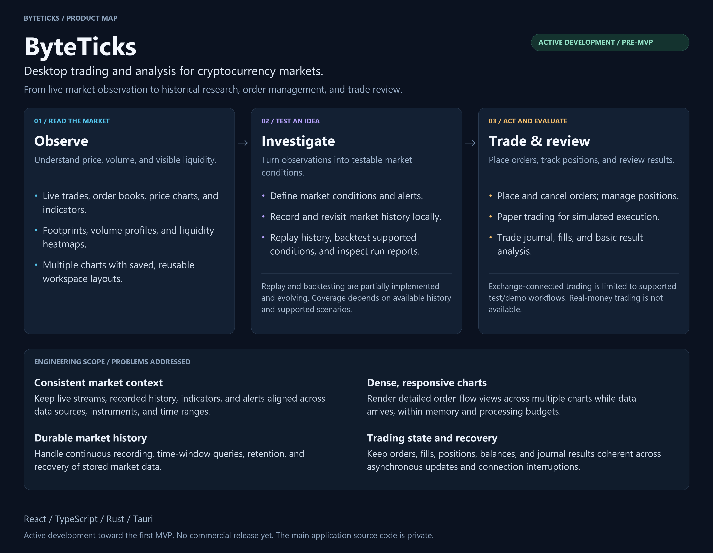

# ByteTicks

ByteTicks is a desktop trading and analysis terminal for cryptocurrency markets. It connects market observation, historical research, and trading workflows in one workspace for traders and market researchers.

## User workflow

### 1. Observe

Understand price, volume, and visible liquidity.

- Live trades, order books, price charts, and indicators.
- Footprints, volume profiles, and liquidity heatmaps.
- Multiple charts with saved, reusable workspace layouts.

### 2. Investigate

Turn observations into testable market conditions.

- Define market conditions and alerts.
- Record and revisit market history locally.
- Replay history, backtest supported conditions, and inspect run reports.

Replay and backtesting are partially implemented and evolving. Coverage depends on available history and supported scenarios.

### 3. Trade & review

Place orders, track positions, and review results.

- Place and cancel orders; manage positions.
- Paper trading for simulated execution.
- Trade journal, fills, and basic result analysis.

Exchange-connected trading is limited to supported test/demo workflows. Real-money trading is not available.

[Editable Obsidian Canvas](product-map/ByteTicks-Product-Map.canvas)

## Engineering scope

These workflows involve concurrent market updates, historical data, interactive charts, and changing trading state. Engineering work addresses:

- **Consistent market context:** Keep live streams, recorded history, indicators, and alerts aligned across data sources, instruments, and time ranges.
- **Dense, responsive charts:** Render detailed order-flow views across multiple charts while data arrives, within memory and processing budgets.
- **Durable market history:** Handle continuous recording, time-window queries, retention, and recovery of stored market data.
- **Trading state and recovery:** Keep orders, fills, positions, balances, and journal results coherent across asynchronous updates and connection interruptions.

**Stack:** React, TypeScript, Rust, and Tauri.

## Status

Active development toward the first MVP. No commercial release yet. The main application source code is private. This repository contains the public product overview.
